<div align="center">


# Grand Theft Ummagine: The Complete Map Guide

**All 20 levels and all 5 bonus rooms, with a drawn map and a tested route for each one. Follow it and you score the full 1,250.**


</div>

---

## 📜 Contents

1. [The heist at a glance](#-the-heist-at-a-glance)
2. [Before you start](#-before-you-start)
3. [How the guards think](#-how-the-guards-think)
4. [How to read the maps](#-how-to-read-the-maps)
5. [The 20 levels](#-the-20-levels)
6. [The three mazes](#-the-three-mazes)
7. [Traps that cost the most points](#-traps-that-cost-the-most-points)

---

## 🗺️ The heist at a glance

```mermaid
flowchart LR
    A([🏜️ 1-4<br/>Desert & city walls]) --> B{{🌿 5<br/>Maze}}
    B --> C([🌴 6-7<br/>Potion, then ring]) --> D[🏰 8<br/>Royal Gardens<br/>★ Bonus 1]
    D --> E[🕳️ 9<br/>Trapdoor halls<br/>★ Bonus 3]
    E --> F([🏛️ 10-11<br/>Palace]) --> G[⚔️ 12<br/>6 guards<br/>★ Bonus 2]
    G --> H{{🧱 13<br/>Maze}} --> I([🌊 14-15<br/>★ Bonus 4]) --> J[🪵 16<br/>Boardwalks]
    J --> K{{🌊 17<br/>Maze}} --> L[🐊 18<br/>Swamp<br/>★ Bonus 5] --> M([🏘️ 19]) --> N[👑 20<br/>Path of Sakhmet]
```

| # | Level | Points | Running total | 🐘 | |
|:-:|---|:-:|:-:|:-:|---|
| 1 | [The End of The Desert](#level-1--the-end-of-the-desert) | 20 | 20 | 1 | Tutorial: one fruit, one sleepy guard |
| 2 | [The Outskirts of The City](#level-2--the-outskirts-of-the-city) | 20 | 40 | 1 | The fruit sits on the exit, guarded |
| 3 | [The Last Oasis Before The City](#level-3--the-last-oasis-before-the-city) | 25 | 65 | 1 | Fruit next to the guard; exit is the bridge |
| 4 | [The Entrance to Sakhmet](#level-4--the-entrance-to-sakhmet) | 40 | 105 | 1 | Guard awake from the start, 2 trapdoors |
| 5 | [The Gardener's Revenge](#level-5--the-gardeners-revenge) | 35 | 140 | — | Random hedge maze |
| 6 | [Avenue of The Palmtrees](#level-6--avenue-of-the-palmtrees) | 35 | 175 | 1 | First potion; guard on the exit |
| 7 | [Bridges Over Troubled Waters](#level-7--bridges-over-troubled-waters) | 40 | 215 | 1 | First ring; bridges and trapdoors |
| 8 | [The Royal Gardens of Sakhmet](#level-8--the-royal-gardens-of-sakhmet) | 80 + ★50 | 345 | 3 | Big garden, 3 guards, both items |
| 9 | [The Three Halls of Insanity](#level-9--the-three-halls-of-insanity) | 50 + ★60 | 455 | — | Trapdoor halls, no guards |
| 10 | [Kyrii Stan meets the Kong Beast](#level-10--kyrii-stan-meets-the-kong-beast) | 35 | 490 | 3 | 3 guards, all awake at once |
| 11 | [The Treasure Chamber of Death](#level-11--the-treasure-chamber-of-death) | 55 | 545 | 3 | 3 guards; leave holding the ring |
| 12 | [The Chambers of The Guards of Death](#level-12--the-chambers-of-the-guards-of-death) | 85 + ★60 | 690 | 6 | 6 guards on a big board |
| 13 | [The Dungeons of Madness](#level-13--the-dungeons-of-madness) | 60 | 750 | — | Random stone maze (36×36) |
| 14 | [Water World](#level-14--water-world) | 50 | 800 | — | No guards; don't get your feet wet |
| 15 | [The Garden of The Holy Shrines](#level-15--the-garden-of-the-holy-shrines) | 45 + ★60 | 905 | 3 | 3 guards; trapdoors by the bonus tile |
| 16 | [Endless Boardwalks](#level-16--endless-boardwalks) | 55 | 960 | 1 | Spiral boardwalks; potion past the guard |
| 17 | [The Raging Rivers](#level-17--the-raging-rivers) | 40 | 1,000 | — | Random river maze |
| 18 | [The Swamps of Oblivion](#level-18--the-swamps-of-oblivion) | 35 + ★65 | 1,100 | 2 | Guards on the bonus tile and the exit |
| 19 | [Eerie Suburbs](#level-19--eerie-suburbs) | 90 | 1,190 | 3 | 3 guards, 2 rings |
| 20 | [The Path of Sakhmet](#level-20--the-path-of-sakhmet) | 60 | 1,250 | — | One safe path through 534 trapdoors |

> [!NOTE]
> **Every level is worth the same for everyone.** The game has no timer and no lives, and the score is capped at **1,250**, which is exactly every item on every level, every level bonus and all five bonus rooms. Speed earns nothing, and neither does a clean run. The only way to lose points is to skip something.

---

## 🎒 Before you start

### The rules

| | |
|---|---|
| 🍑 **Stealing** | Each piece of loot is worth **10**. A potion or a ring is worth **15**, and you can also use it. |
| 🚪 **The exit** | The marked exit tile **stays shut until you've stolen everything on the level** (*"You have to steal everything first!"*). Reaching it then adds the level bonus. |
| ⭐ **Bonus rooms** | Levels 8, 9, 12, 15 and 18 each hide a bonus-room tile. Step on it and you're taken to a small room with no guards. Steal everything and leave by its exit, and you come back to the same tile. Each room can be entered **once**. The five rooms are worth **295** together, so you can't reach 1,250 without them. |
| 💀 **Getting caught** | There are no lives. Getting caught or falling through a trapdoor restarts the level. You lose that level's points so far, but you keep everything from earlier levels and from bonus rooms (with one exception; see [Traps](#-traps-that-cost-the-most-points)). |
| ⏱️ **Time** | There's no clock. Take as long as you like. |
| 🏆 **Rewards** | The score is capped at 1,250. According to Jellyneo, a sent score **over 1,100** awards the game's avatar. |

### Controls

| | |
|---|---|
| ⌨️ **Arrow keys** | **Tap, don't hold.** One tap sets Stan walking, and he keeps going until he hits something or you tap again. Tapping the direction he's **already** walking in **stops** him. |
| ↪️ **Turning** | Stan turns on the tile he's standing on when you tap. Tap **as he arrives** on the turning tile. A little late is fine, but early turns him one tile too soon. |
| 🧪 **Items** | Click the potion or ring icon in the bottom-left corner with the mouse. |
| 🧭 **Which way is up** | The view is isometric, so each key moves Stan **diagonally** on screen: **↑ = up-right, → = down-right, ↓ = down-left, ← = up-left**. Every map in this guide has this compass in the corner. |
| 🖥️ **Big levels** | Levels bigger than the screen scroll in jumps of 6 tiles as Stan nears an edge. |
| 🔑 **Level codes** | After levels 5, 9, 13 and 17 the game gives you a level code (*Use Level Code* on the menu). It's tied to your username. A game started from a code **doesn't include the earlier levels' points**, so use codes for practice and play the scoring run from level 1. |
| 🚶 **Leave Game** | Ends the run and shows your total, ready to send. |

---

## 🐘 How the guards think

The Elephante guards are, in the game's own words, *"fast, but also short-sighted and dumb"*. Each part of that is a rule you can use.

| Rule | What it means for you |
|---|---|
| 😴 **They sleep until you're close.** A guard wakes when you're within **5 tiles** of him in both directions on levels 1–8, and within **9 tiles** from level 9 on. | On levels 1–8 the dashed box on the map is his wake-up zone. Stay outside it and he never moves. From level 9 on, the zone covers most of a 12×12 level. |
| 📺 **Only guards on screen move.** | On the big levels, a guard who's off screen is frozen until the view scrolls to him. |
| 🏃 **They're faster than you.** | You can't outrun one on open ground. |
| ↗️ **They always line up first.** *"The big fella will always walk in one direction first!"* A guard first walks along the ↑/↓ line until he's level with you, and only then along the ←/→ line toward you. | If a wall is in his way while he's lining up, he **gets stuck** against it and stays there for as long as you stay on a different line. |
| 🛑 **They give up where they stand.** If you get far enough away (outside his zone), he stops on the spot. | He **doesn't walk back to his post**. A guard you lured away stays where you left him. |
| 💥 **Caught means the same tile.** | Being next to him is safe. Only stepping onto his tile, or him stepping onto yours, counts as caught. |
| 🧪 **Potion** (5 seconds). Stan looks like a guard. | A guard who bumps into you is fooled and **stops chasing**. He stays fooled until the potion wears off or you leave his zone. Use it to walk **through** a guard. |
| 💍 **Ring** (5 seconds). Stan turns see-through. | No guard **starts** a chase, and any guard already chasing you **stops dead**. Walking into one still gets you caught (*"they still have a very good sense of smell"*). |

> [!TIP]
> **An item you're holding when a level starts comes back every time you retry that level, even if you used it.** You can only hold one potion and one ring at a time, and you can't use both at once. Bringing a spare into a hard level means you get it on every attempt.

---

## 🧭 How to read the maps

Every map is drawn the way the game shows it, with the same diagonal view, so you can hold the guide up next to the screen.

| Symbol | Meaning |
|:-:|---|
|  | Where Stan starts |
|  | Loot (10 points) |
|   | Potion / ring (15 points each, and usable) |
|  | Bonus-room tile |
|  | A guard's starting tile. On levels 1–8, his wake-up zone is the dashed box around him |
|  | The exit |
|  | **Trapdoor.** Stepping on it drops you and restarts the level. Many look like ordinary floor |
|  | The route. Each colour is one leg, matching the numbered badge at the end of it. Arrows show which way to walk |
|  | A tile where you tap a key |

Under each map, **Key taps** gives the same route as key taps:

```
    START → 1 loot     ↓ 5   → 8
        1 → EXIT       ↓ 5   ← 2
```

`↓ 5` means *tap ↓ once and Stan walks 5 tiles; make the next tap there*. A few routes also use:

- `⏸1s →` means **stop and count**. Tap the key Stan is already walking in to stop him, wait about a second, then tap →.
- `⏳ →` means **stop and watch**. Stop him, wait until **no guard is moving**, then tap →.
- `·3 ↑` means **tap again a beat later**. Don't stop: count three ticks (about a fifth of a second) after your last tap, then tap ↑. Only level 12's second half and level 18's fallback route use this.
- 🧪 / 💍 means click the potion / ring now. The map marks the tile.

> [!IMPORTANT]
> **The routes are tested, not guessed.** Every route was played in a tick-by-tick model of the game's own code, with each tap landing late by a random amount, and kept only if Stan survived. The box under each map says how often the route survives with taps up to 2 and 3 ticks late (a tick is about 1/15 of a second). If a guard isn't where the map expects, don't push on. You can always stop, look, and work around him using the rules above.

---

## 🧗 The 20 levels

### Level 1 — The End of The Desert

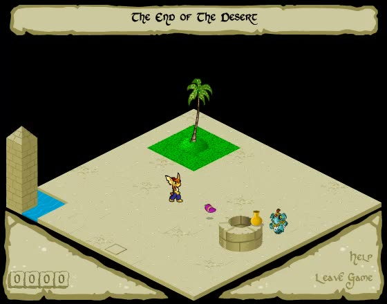

> *The endless desert finally ended! Steal the ummagine, and get to the marked tile. Watch out for the guard, however. He is fast, but also short sighted and dumb! Don't hold the button down while guiding Stan!*

| 💰 Points | 🍑 To steal | 🐘 Guards | 🕳️ Trapdoors | ⭐ Bonus room | 🗺️ Size |
|:-:|---|:-:|:-:|---|:-:|
| **20** | 1 loot | 1 | — | — | 12×12 |


- The guard only wakes once you're within 5 tiles of him, so he sleeps until you're next to the fruit.
- Grab the fruit and keep walking. By the time he's lined up with you, you're on the exit.

<br clear="right">

<p align="center">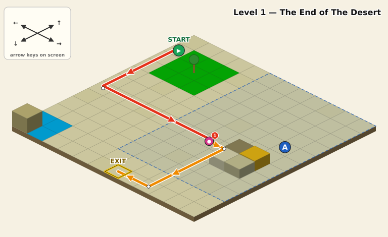</p>

<details>
<summary><b>⌨️ Key taps — Level 1</b> (4 taps)</summary>

```
    START → 1 loot     ↓ 5   → 8
        1 → EXIT       ↓ 5   ← 2
```

🟢 **Forgiving.** In the model, this route got through 100% of runs with taps up to 1 tick late, 100% up to 2 ticks and 100% up to 3 ticks (a tick is about 1/15 s).

</details>


<div align="right"><sub><a href="#-contents">↑ back to top</a></sub></div>

---

### Level 2 — The Outskirts of The City

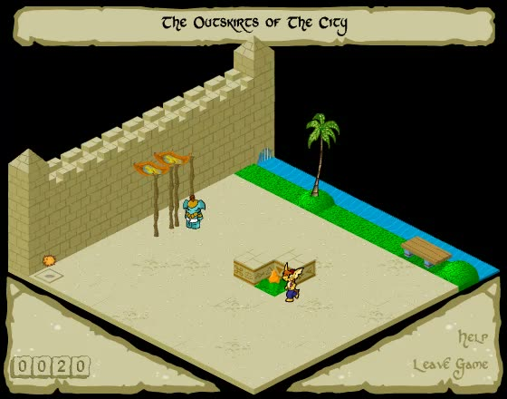

> *You reached the outer walls of the City Of Sakhmet! Get to the fruit without getting caught by the Guard. Watch - the big fella will always walk in one direction first! Remember, don't hold the button down while guiding Stan!*

| 💰 Points | 🍑 To steal | 🐘 Guards | 🕳️ Trapdoors | ⭐ Bonus room | 🗺️ Size |
|:-:|---|:-:|:-:|---|:-:|
| **20** | 1 loot | 1 | — | — | 12×12 |


- **Two layouts, picked at random.** If Stan starts right in the right-hand corner, it's **layout B**. If he starts a few tiles in from it, it's **layout A**.
- The fruit sits on the exit, and the guard sleeps two tiles from it. Both routes go the long way round, down to the bottom edge and along it to the exit. Keep walking along that last stretch; stopping there is what gets you caught.

<br clear="right">

#### Layout A

<p align="center">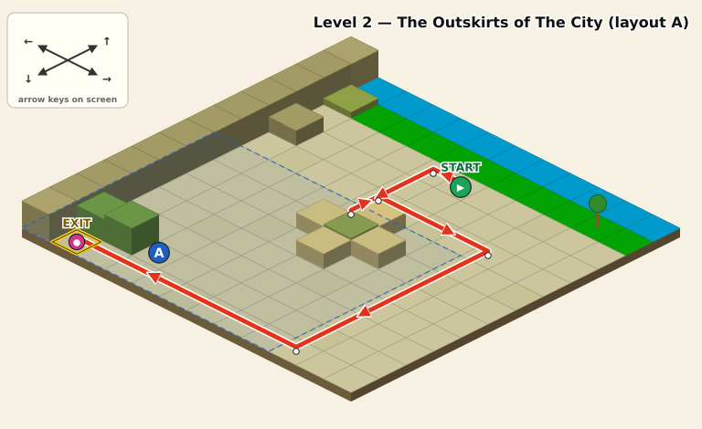</p>

<details>
<summary><b>⌨️ Key taps — Level 2 layout A</b> (6 taps)</summary>

```
    START → EXIT       ← 1   ↓ 3   ↑ 1   → 4   ↓ 7   ← 8
```

🟢 **Forgiving.** In the model, this route got through 100% of runs with taps up to 1 tick late, 100% up to 2 ticks and 100% up to 3 ticks (a tick is about 1/15 s).

</details>

#### Layout B

<p align="center">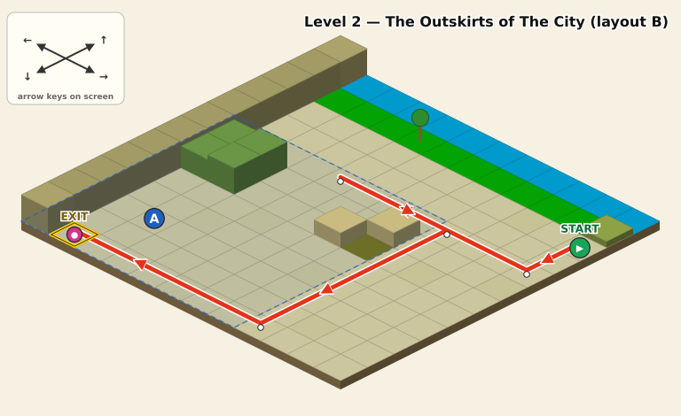</p>

<details>
<summary><b>⌨️ Key taps — Level 2 layout B</b> (5 taps)</summary>

```
    START → EXIT       ↓ 2   ← 7   → 4   ↓ 7   ← 7
```

🟢 **Forgiving.** In the model, this route got through 100% of runs with taps up to 1 tick late, 100% up to 2 ticks and 100% up to 3 ticks (a tick is about 1/15 s).

</details>


<div align="right"><sub><a href="#-contents">↑ back to top</a></sub></div>

---

### Level 3 — The Last Oasis Before The City

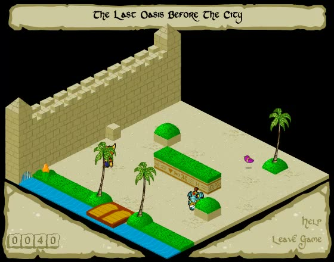

> *Excellent Execution! Make your way to the bridge to cross the city's river. Once again, stay away from the guard, and don't forget to take that yummy fruit with you!*

| 💰 Points | 🍑 To steal | 🐘 Guards | 🕳️ Trapdoors | ⭐ Bonus room | 🗺️ Size |
|:-:|---|:-:|:-:|---|:-:|
| **25** | 1 loot | 1 | — | — | 12×12 |


- **Two layouts.** Stan starts in the **top corner** in layout A and in the **right-hand corner** in layout B. The fruit is always a couple of tiles from the guard, so he will wake. The exit is the bridge at the bottom.
- In layout A the route walks in, takes the fruit and heads straight down to the bridge before the guard has lined up.
- Layout B is the hardest early route. After the fruit comes a run of **one-tile taps** (→ 1, ↓ 1, → 1, …) that keeps Stan off the guard's line. Tap once per tile, as Stan lands on each. If you're caught, you only lose this level's 25 points, so practise it.

<br clear="right">

#### Layout A

<p align="center">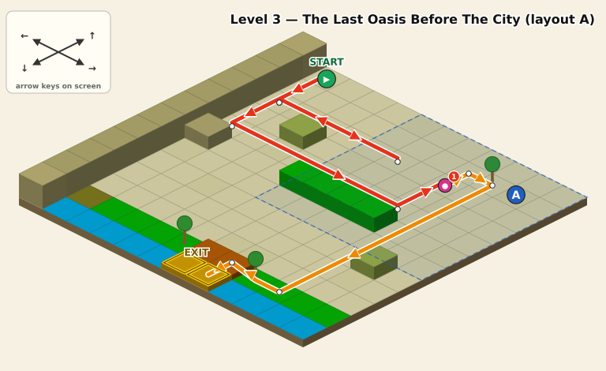</p>

<details>
<summary><b>⌨️ Key taps — Level 3 layout A</b> (10 taps)</summary>

```
    START → 1 loot     ↓ 2   → 5   ← 5   ↓ 2   → 7   ↑ 3
        1 → EXIT       → 1   ↓ 9   ← 2   ↓ 1
```

🟡 **Needs good timing.** In the model, this route got through 100% of runs with taps up to 1 tick late, 78% up to 2 ticks and 54% up to 3 ticks (a tick is about 1/15 s).

</details>

#### Layout B

<p align="center">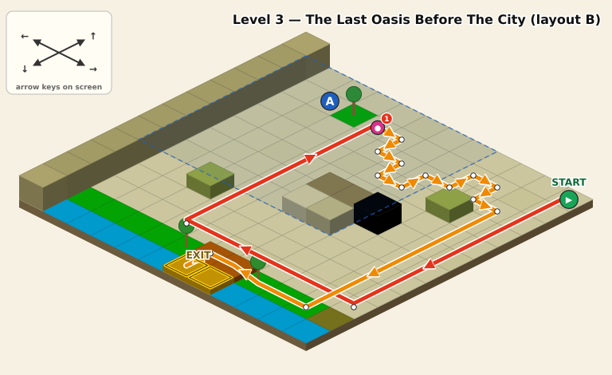</p>

<details>
<summary><b>⌨️ Key taps — Level 3 layout B</b> (17 taps)</summary>

```
    START → 1 loot     ↓ 9   ← 7   ↑ 8
        1 → EXIT       → 1   ↓ 1   → 1   ↓ 1   → 1   ↑ 1   → 1   ↑ 1   → 1   ↓ 1   → 1   ↓ 8   ← 4   ↓ 1
```

🟡 **Needs good timing.** In the model, this route got through 100% of runs with taps up to 1 tick late, 49% up to 2 ticks and 4% up to 3 ticks (a tick is about 1/15 s).

</details>


<div align="right"><sub><a href="#-contents">↑ back to top</a></sub></div>

---

### Level 4 — The Entrance to Sakhmet

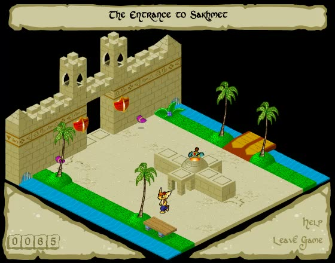

> *Phew, that was close! Make it to the entrance of Sakhmet City. Don't be too hasty, and make sure that you don't enter empty handed!*

| 💰 Points | 🍑 To steal | 🐘 Guards | 🕳️ Trapdoors | ⭐ Bonus room | 🗺️ Size |
|:-:|---|:-:|:-:|---|:-:|
| **40** | 2 loot | 1 | 2 | — | 12×12 |


- The guard is close enough to wake as soon as you start, so don't stand still to read the map. Have the first few taps ready.
- There are two trapdoors. The one in the left corner sits right beside loot 2, so count your tiles on that leg.

<br clear="right">

<p align="center">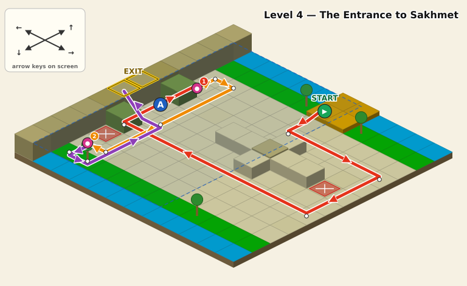</p>

<details>
<summary><b>⌨️ Key taps — Level 4</b> (12 taps)</summary>

```
    START → 1 loot     ↓ 2   → 5   ↓ 4   ← 10   ↑ 5
        1 → 2 loot     → 1   ↓ 7   ← 1
        2 → EXIT       ↓ 1   → 1   ↑ 4   ← 2
```

🟢 **Forgiving.** In the model, this route got through 100% of runs with taps up to 1 tick late, 100% up to 2 ticks and 100% up to 3 ticks (a tick is about 1/15 s).

</details>


<div align="right"><sub><a href="#-contents">↑ back to top</a></sub></div>

---

### Level 5 — The Gardener's Revenge

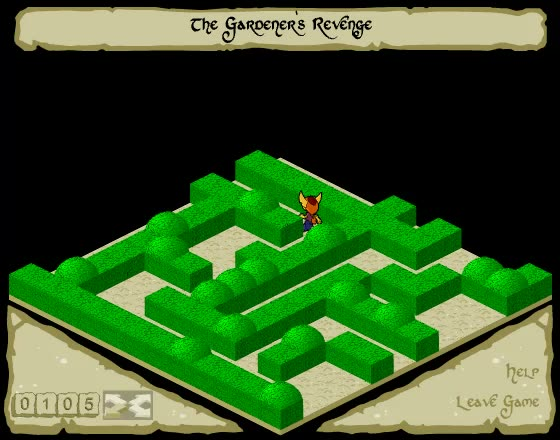

> *So far so good... Did you really think it is that easy?? Unfortunately the gardens have been secured by a crazy maze to keep uninvited guests (like you) out of the palace! Good luck, and look out for the fruit that marks the maze exit.*

| 💰 Points | 🍑 To steal | 🐘 Guards | 🕳️ Trapdoors | ⭐ Bonus room | 🗺️ Size |
|:-:|---|:-:|:-:|---|:-:|
| **35** | 1 loot | — | — | — | 24×24 |


- **A new maze every game.** You start in the bottom corner, and the exit and the fruit are together in the top corner. See [The three mazes](#-the-three-mazes) for how to get through any of them.
- After this level the game shows your first **level code**.

<br clear="right">

<p align="center">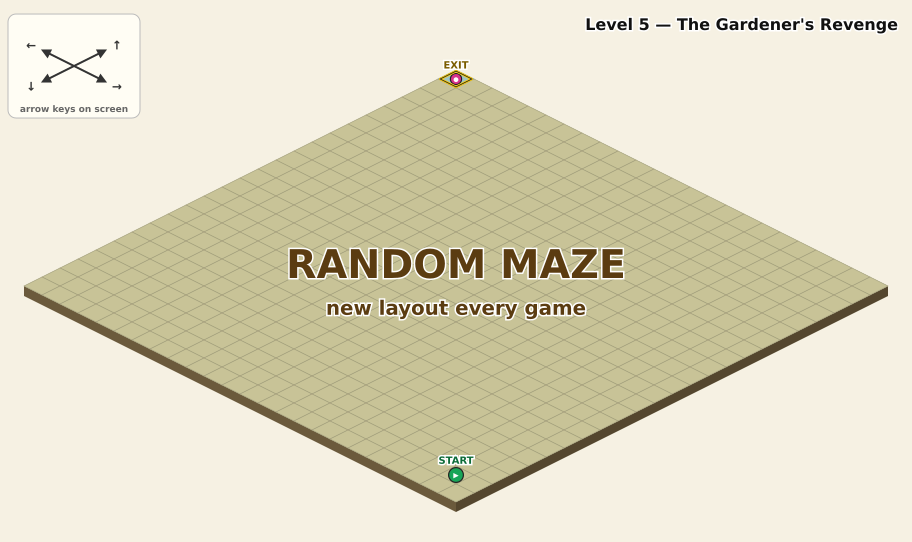</p>


<div align="right"><sub><a href="#-contents">↑ back to top</a></sub></div>

---

### Level 6 — Avenue of The Palmtrees

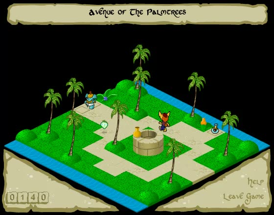

> *Got a little confused there? Well done, you found the right path! On this level look out for the magical potion. You can use it to fool the guard, but watch out, it will only last a few seconds!*

| 💰 Points | 🍑 To steal | 🐘 Guards | 🕳️ Trapdoors | ⭐ Bonus room | 🗺️ Size |
|:-:|---|:-:|:-:|---|:-:|
| **35** | 1 loot · 1 potion | 1 | — | — | 12×12 |


- **Two layouts**, and in both the guard stands **on the exit**. You can't sneak past him, so this is the level that teaches the potion.
- Take the potion first, then the loot. Walk back towards the exit and click the potion on the marked tile (🧪). Then walk straight on through the guard. He touches you and gives up.
- The potion only lasts about **5 seconds**. Click it on the marked tile, not sooner, or it runs out before you reach the door.

<br clear="right">

#### Layout A

<p align="center">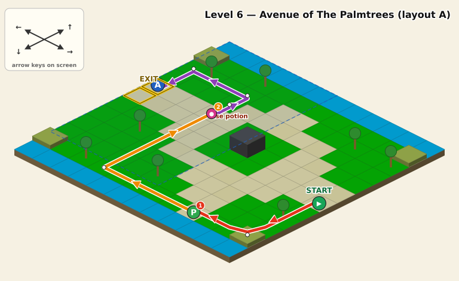</p>

<details>
<summary><b>⌨️ Key taps — Level 6 layout A</b> (6 taps)</summary>

```
    START → 1 potion   ↓ 4   ← 8
        1 → 2 loot     ↑ 7
        2 → EXIT       🧪   ← 3   ↓ 2
```

🟢 **Forgiving.** In the model, this route got through 100% of runs with taps up to 1 tick late, 100% up to 2 ticks and 100% up to 3 ticks (a tick is about 1/15 s).

</details>

#### Layout B

<p align="center">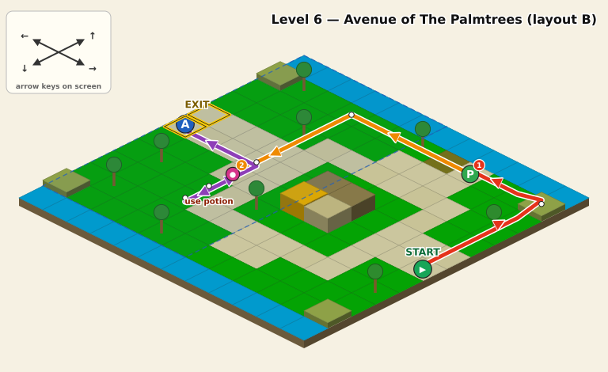</p>

<details>
<summary><b>⌨️ Key taps — Level 6 layout B</b> (6 taps)</summary>

```
    START → 1 potion   ↑ 5   ← 8
        1 → 2 loot     ↓ 6
        2 → EXIT       🧪   ↑ 3   ← 3
```

🟢 **Forgiving.** In the model, this route got through 100% of runs with taps up to 1 tick late, 100% up to 2 ticks and 100% up to 3 ticks (a tick is about 1/15 s).

</details>


<div align="right"><sub><a href="#-contents">↑ back to top</a></sub></div>

---

### Level 7 — Bridges Over Troubled Waters

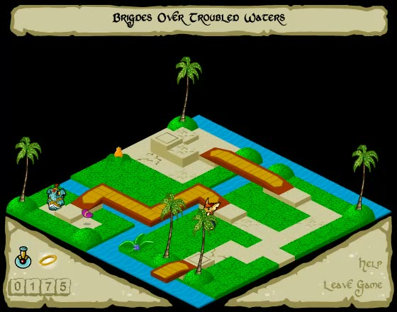

> *Very Good... You learned quickly! Another cool magical item is the Ring of Invisibilty, and you can find it on this level. Be careful though, the Elephante Guards still have a very good sense of smell!*

| 💰 Points | 🍑 To steal | 🐘 Guards | 🕳️ Trapdoors | ⭐ Bonus room | 🗺️ Size |
|:-:|---|:-:|:-:|---|:-:|
| **40** | 1 loot · 1 ring | 1 | 2 | — | 12×12 |


- The ring is in the far corner and the loot is down among the bridges. Several of the bridge tiles are **trapdoors**: follow the route tile for tile, the map shows where they are.
- The middle leg is a long run of short taps across the bridges. Tap as Stan lands on each tile.
- At the end, put the **ring** on (💍) as you head back past the guard. While it lasts he won't start a chase. It doesn't make you a ghost, though: walk *into* him and you're still caught.

<br clear="right">

<p align="center">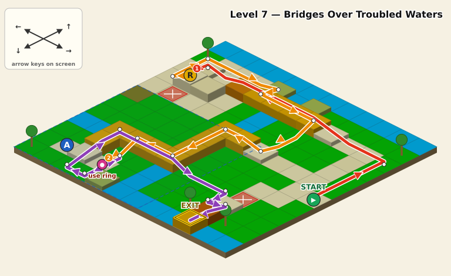</p>

<details>
<summary><b>⌨️ Key taps — Level 7</b> (22 taps)</summary>

```
    START → 1 ring     ↑ 4   ← 10   ↓ 1
        1 → 2 loot     ← 1   ↑ 2   → 4   ↓ 1   → 3   ↓ 3   ← 2   ↓ 3   ← 2   ↓ 2
        2 → EXIT       ↑ 1   ↓ 1   💍   ← 1   ↑ 3   → 6   ↓ 1   → 1   ↓ 2
```

🟡 **Needs good timing.** In the model, this route got through 100% of runs with taps up to 1 tick late, 96% up to 2 ticks and 71% up to 3 ticks (a tick is about 1/15 s).

</details>


<div align="right"><sub><a href="#-contents">↑ back to top</a></sub></div>

---

### Level 8 — The Royal Gardens of Sakhmet

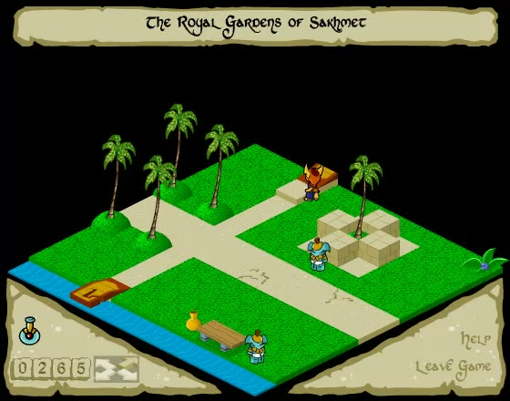

> *Harhar... He didn't see you coming! You are nearly at the palace, but watch out - it's not that easy. Use everything you have learned so far to sneak past the guards and get inside!*

| 💰 Points | 🍑 To steal | 🐘 Guards | 🕳️ Trapdoors | ⭐ Bonus room | 🗺️ Size |
|:-:|---|:-:|:-:|---|:-:|
| **80** | 3 loot · 1 potion · 1 ring | 3 | 9 | ★ [Bonus Level 1](#-bonus-level-1--the-hidden-pit) | 24×24 |


- **The first big level, and the first where you play the guards against the walls.** You arrive with nothing in your bag, so the route uses no items until the very end.
- Take the near loot and the bonus room first. Then comes the clever part:
  - The **`↓ 3   ↑ 3`** in leg 3 is on purpose. It steps into guard **B**'s zone to wake him and walks straight back out. He follows you up and gets stuck against a wall, and he stays there.
  - The long walk west and back east past the top does the same to guard **A**: he follows you along the top and wedges under a block. That leaves the potion's corridor in the top corner free.
  - With A and B both stuck, the whole bottom half is yours: two loot, then round the long way to the ring.
- Guard **C** stands right beside the exit. Put the **ring** on just before you get there (💍 in the last leg): while it lasts he won't start a chase, and the route never steps onto his tile. **Keep the potion** you picked up: level 10 needs it.

<br clear="right">

<p align="center">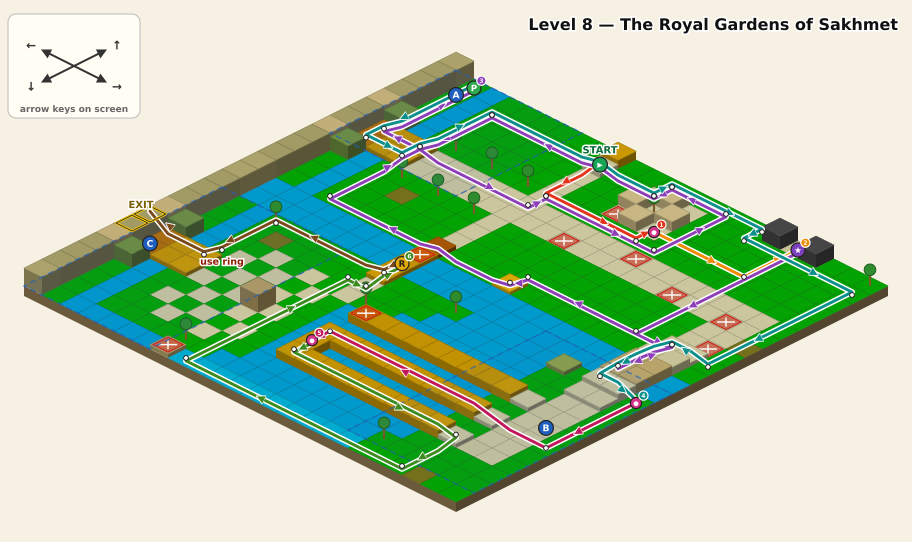</p>

<details>
<summary><b>⌨️ Key taps — Level 8</b> (49 taps)</summary>

```
    START → 1 loot     ↓ 3   → 5   ↑ 1
        1 → 2 ★ bonus  → 5   ↑ 3
        2 → 3 potion   ↓ 9   → 2   ↓ 3   ↑ 3   ← 8   ↓ 1   ← 10   ↑ 5   → 6   ↑ 1   → 6   ↑ 4   ← 3   ↓ 1   ← 9   ↓ 4   ← 2   ↑ 5
        3 → 4 loot     ↓ 6   → 2   ↑ 5   → 9   ↑ 1   → 5   ↓ 1   → 6   ↓ 8   ← 2   ↓ 4   → 2
        4 → 5 loot     ↓ 5   ← 12   ↓ 2
        5 → 6 ring     → 9   ↓ 3   ← 12   ↑ 9   → 1   ↑ 2
        6 → EXIT       ↓ 1   ← 6   ↓ 3   💍   ← 3
```

🟡 **Needs good timing.** In the model, this route got through 100% of runs with taps up to 1 tick late, 94% up to 2 ticks and 61% up to 3 ticks (a tick is about 1/15 s).

> [!IMPORTANT]
> 🎒 **Leave still holding the potion for level 10**: don't spend it here beyond what the taps say.

</details>


#### ★ Bonus Level 1 — The Hidden Pit

> *This looks like a secret cave! Steal everything you can find and leave, before the guards smell you!*

- No guards and no traps. Loot sits on and around the low walls. Some ledges can only be climbed from one side, so follow the route.

<p align="center">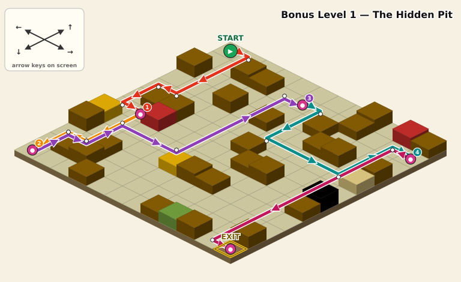</p>

<details>
<summary><b>⌨️ Key taps — Bonus Level 1</b> (21 taps)</summary>

```
    START → 1 loot     → 1   ↓ 4   ← 1   ↓ 2   → 1
        1 → 2 loot     ↓ 3   ← 1   ↓ 2
        2 → 3 loot     ↑ 2   → 1   ↑ 2   → 3   ↑ 6   → 2
        3 → 4 loot     ↓ 3   → 4   ↑ 3   → 1
        4 → EXIT       ← 1   ↓ 10   → 1
```

🟢 **Forgiving.** In the model, this route got through 100% of runs with taps up to 1 tick late, 100% up to 2 ticks and 100% up to 3 ticks (a tick is about 1/15 s).

</details>


<div align="right"><sub><a href="#-contents">↑ back to top</a></sub></div>

---

### Level 9 — The Three Halls of Insanity

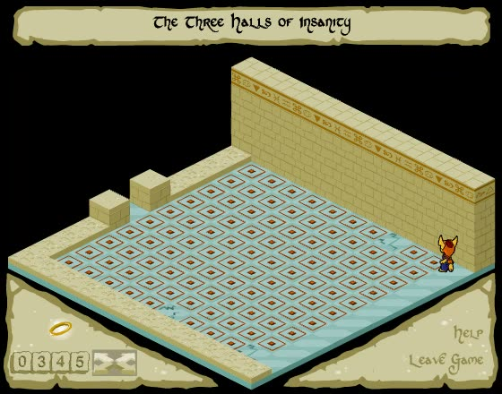

> *Well, that was easy, wasn't it? Well, you made it in through the back door, well done. Unfortunately, some traps have been laid to keep unwelcome intruders (like you) out... uh oh.*

| 💰 Points | 🍑 To steal | 🐘 Guards | 🕳️ Trapdoors | ⭐ Bonus room | 🗺️ Size |
|:-:|---|:-:|:-:|---|:-:|
| **50** | 1 loot | — | 191 | ★ [Bonus Level 3](#-bonus-level-3--the-secret-temple) | 24×24 |


- **No guards, but most of the floor is trapdoor.** The three halls are rows of trapdoors with one-tile lanes between them, and the trapdoors look just like the lanes. Every red tile on the map is a trapdoor.
- The bonus tile is in the far left corner of the bottom hall, at the end of a dead-end lane. Collect it first, then walk the same lane back out.
- It's a long walk (about 240 tiles) but there's nothing to dodge. Take it slowly and count the tiles; it's the counting that matters here.

<br clear="right">

<p align="center">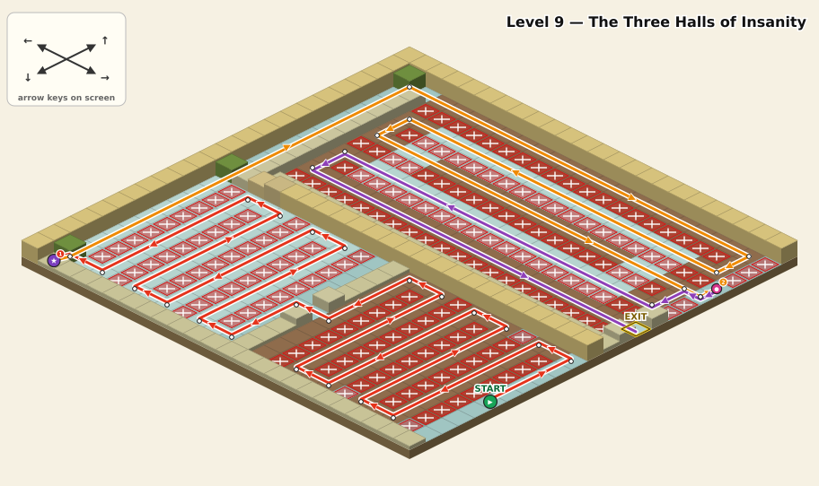</p>

<details>
<summary><b>⌨️ Key taps — Level 9</b> (36 taps)</summary>

```
    START → 1 ★ bonus  ↑ 5   ← 2   ↓ 9   ← 2   ↑ 9   ← 2   ↓ 9   ← 2   ↑ 9   ← 2   ↓ 5   ← 2   ↓ 4   ← 2   ↑ 9   ← 2   ↓ 9   ← 2   ↑ 9   ← 2   ↓ 9   ← 2   ↓ 1
        1 → 2 loot     ↑ 22   → 21   ↓ 2   ← 19   ↓ 2   → 20   ↑ 1
        2 → EXIT       ↓ 1   ← 1   ↓ 2   ← 19   ↓ 2   → 20
```

🟢 **Forgiving.** In the model, this route got through 100% of runs with taps up to 1 tick late, 100% up to 2 ticks and 100% up to 3 ticks (a tick is about 1/15 s).

</details>


#### ★ Bonus Level 3 — The Secret Temple

> *Check this out! You found the secret temple! Steal everything you can find and get out of here!*

- No guards. The temple is a square spiral with loot on every ring. It's long but safe. The exit is the far corner.

<p align="center">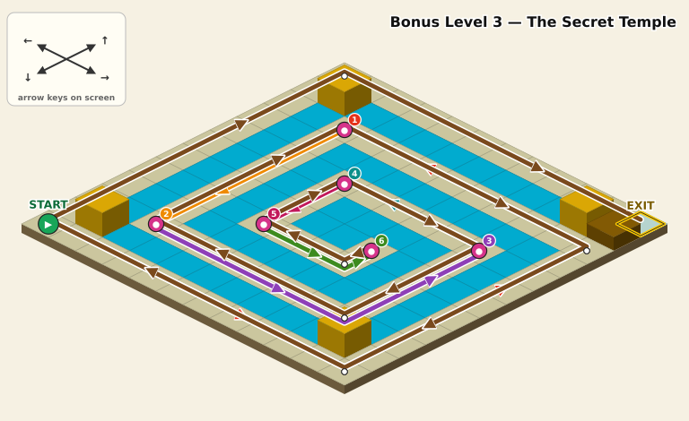</p>

<details>
<summary><b>⌨️ Key taps — Bonus Level 3</b> (22 taps)</summary>

```
    START → 1 loot     → 11   ↑ 9   ← 9
        1 → 2 loot     ↓ 7
        2 → 3 loot     → 7   ↑ 5
        3 → 4 loot     ← 5
        4 → 5 loot     ↓ 3
        5 → 6 loot     → 3   ↑ 1
        6 → EXIT       ↓ 1   ← 3   ↑ 3   → 5   ↓ 5   ← 7   ↑ 7   → 9   ↓ 9   ← 11   ↑ 11   → 11
```

🟢 **Forgiving.** In the model, this route got through 100% of runs with taps up to 1 tick late, 100% up to 2 ticks and 100% up to 3 ticks (a tick is about 1/15 s).

</details>


<div align="right"><sub><a href="#-contents">↑ back to top</a></sub></div>

---

### Level 10 — Kyrii Stan meets the Kong Beast

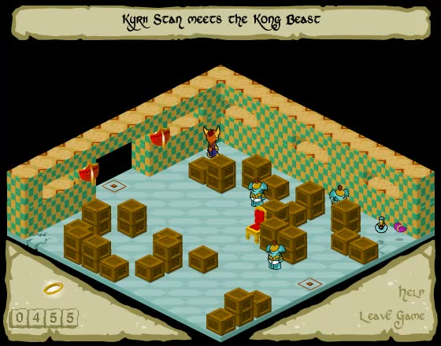

> *Whoa! Only a few have ever got this far! Inside the palace the guards are not as short sighted, so don't get too close to them. They are still quite dumb though so you should have no trouble outwitting them!*

| 💰 Points | 🍑 To steal | 🐘 Guards | 🕳️ Trapdoors | ⭐ Bonus room | 🗺️ Size |
|:-:|---|:-:|:-:|---|:-:|
| **35** | 1 loot · 1 potion | 3 | 2 | — | 12×12 |


- 🎒 You arrive holding **level 8's potion**. Three guards wake as soon as you move.
- Walk up, turn onto the top row and **click your potion straight away** (🧪). Keep walking along the row while it lasts: any guard who reaches you gives up. This level's own potion and the loot are at the far end. The new potion goes into your bag, so you **leave still holding a potion**.

<br clear="right">

<p align="center">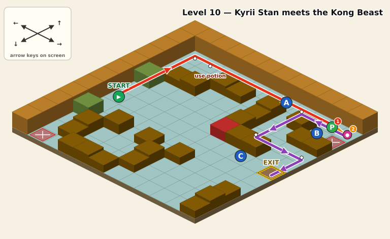</p>

<details>
<summary><b>⌨️ Key taps — Level 10</b> (7 taps)</summary>

```
    START → 1 potion   ↑ 5   → 1   🧪
        1 → 2 loot     (keep going)
        2 → EXIT       ← 3   ↓ 3   → 3   ↓ 2
```

🟢 **Forgiving.** In the model, this route got through 100% of runs with taps up to 1 tick late, 100% up to 2 ticks and 100% up to 3 ticks (a tick is about 1/15 s).

> [!IMPORTANT]
> 🎒 Arrive holding the potion (from level 8). Whatever you hold when a level starts comes back every time you retry it.
> **Leave still holding the potion for level 11**: don't spend it here beyond what the taps say.

</details>


<div align="right"><sub><a href="#-contents">↑ back to top</a></sub></div>

---

### Level 11 — The Treasure Chamber of Death

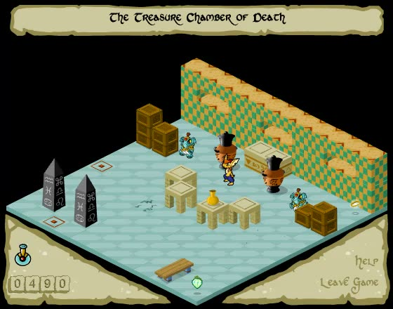

> *You are indeed the master of thieves! The guards are everywhere, this is getting insane. Make sure you keep one of the magical items you find on this level, it will help you in the future.*

| 💰 Points | 🍑 To steal | 🐘 Guards | 🕳️ Trapdoors | ⭐ Bonus room | 🗺️ Size |
|:-:|---|:-:|:-:|---|:-:|
| **55** | 1 loot · 1 potion · 1 ring | 3 | 1 | — | 12×12 |


- 🎒 You arrive holding **level 10's potion**, and you leave holding **this level's ring**. The game's hint means it: level 12 tells you it hopes you kept it, and level 15's route puts it on. Never put the ring on here.
- The guards wake almost at once. **Click your potion early** (🧪 in leg 1) and use it to get to the ring. Then pick up the board's potion and click that one too (the second 🧪) while you take the loot.
- `⏸1s` in the last leg means stand still for about a second before going on, to let a guard walk past.
- This one is tighter than anything before it: the route holds with taps up to a tick late but fails a third of runs at two ticks. Tap as Stan reaches the tile, not after.

<br clear="right">

<p align="center">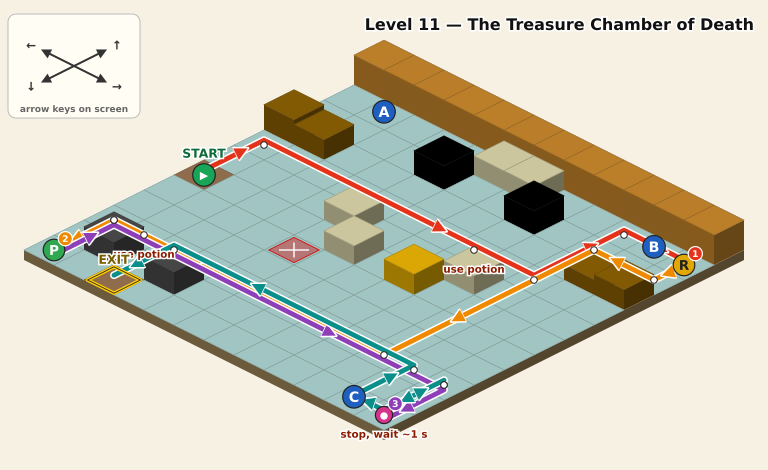</p>

<details>
<summary><b>⌨️ Key taps — Level 11</b> (20 taps)</summary>

```
    START → 1 ring     ↑ 2   → 7   🧪   ↑ 3   → 2
        1 → 2 potion   ↓ 1   ← 2   ↓ 7   ← 9   ↓ 2
        2 → 3 loot     ↑ 2   → 1   🧪   ↓ 2
        3 → EXIT       ⏸1s ↑ 2   ↓ 2   ← 1   ↑ 2   ← 8   ↓ 2
```

🟡 **Needs good timing.** In the model, this route got through 95% of runs with taps up to 1 tick late, 65% up to 2 ticks and 15% up to 3 ticks (a tick is about 1/15 s).

> [!IMPORTANT]
> 🎒 Arrive holding the potion (from level 10). Whatever you hold when a level starts comes back every time you retry it.
> **Leave still holding the ring for level 15**: don't spend it here beyond what the taps say.

</details>


<div align="right"><sub><a href="#-contents">↑ back to top</a></sub></div>

---

### Level 12 — The Chambers of The Guards of Death

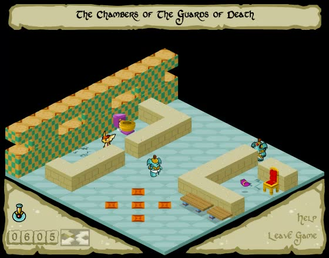

> *Now... let's see how clever you REALLY are! I hope you kept that magic ring!! These guards are like bloodhounds! Maybe there is another way to complete this level though...*

| 💰 Points | 🍑 To steal | 🐘 Guards | 🕳️ Trapdoors | ⭐ Bonus room | 🗺️ Size |
|:-:|---|:-:|:-:|---|:-:|
| **85** | 5 loot · 1 potion | 6 | 5 | ★ [Bonus Level 2](#-bonus-level-2--the-hidden-chamber) | 24×24 |


- *"Maybe there is another way to complete this level"*: the other way is the **bonus room**. Walk there first (part 1): its points are banked the moment you step in.
- Part 2 starts with you **walking into a guard on purpose**. You've taken nothing yet and the bonus room's points are already banked, so it costs nothing.
- **Keep the ring in your bag.** Despite the game's hint, this route never puts it on: level 15 needs it. Part 2 picks up the board's potion near the end and clicks it (🧪) just before the last loot.
- **This is the hardest level in the guide.** Part 2 has 101 taps, some of them `·3 ↑` beats (tap, count three ticks, tap again), and five ⚠ taps that must land on the exact tick. In the model only 14% of runs survive taps a tick late. There are no lives in this game, so every failure only costs time: you restart part 2 with the ring still in your bag.

<br clear="right">

#### Part 1 — bonus room first

Go to the bonus room before you touch anything else. The walk there is short and only wakes the nearest guard.

<p align="center">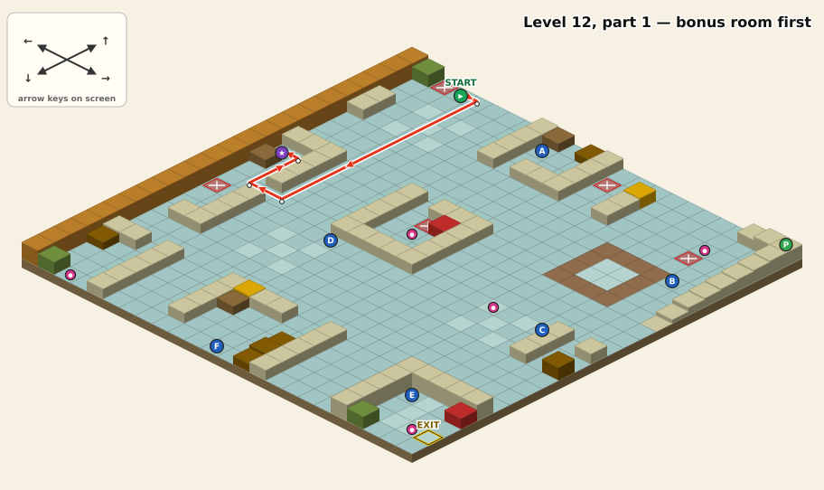</p>

<details>
<summary><b>⌨️ Key taps — Level 12, part 1: bonus room first</b> (5 taps)</summary>

```
    START → EXIT       → 1   ↓ 12   ← 2   ↑ 3   ← 1
```

🟢 **Forgiving.** In the model, this route got through 100% of runs with taps up to 1 tick late, 100% up to 2 ticks and 100% up to 3 ticks (a tick is about 1/15 s).

> [!IMPORTANT]
> 🎒 Arrive holding the ring (from level 11). Whatever you hold when a level starts comes back every time you retry it.
> **Leave still holding the ring for level 15**: don't spend it here beyond what the taps say.

</details>

#### Part 2 — the sweep

Back from the room, the guards are no longer where they started, and no route was found from there. **Walk into a guard on purpose.** It costs nothing: you haven't stolen anything on this level yet, the bonus room's points are already banked, and the room stays used. The level restarts with every guard back at their posts, and this route clears it.

This is the hardest route in the guide. The taps marked ⚠ have to land on the exact beat: in the model a tap one tick late fails most runs. Expect many tries. Each failure only restarts part 2, with the bonus room still banked.

<p align="center">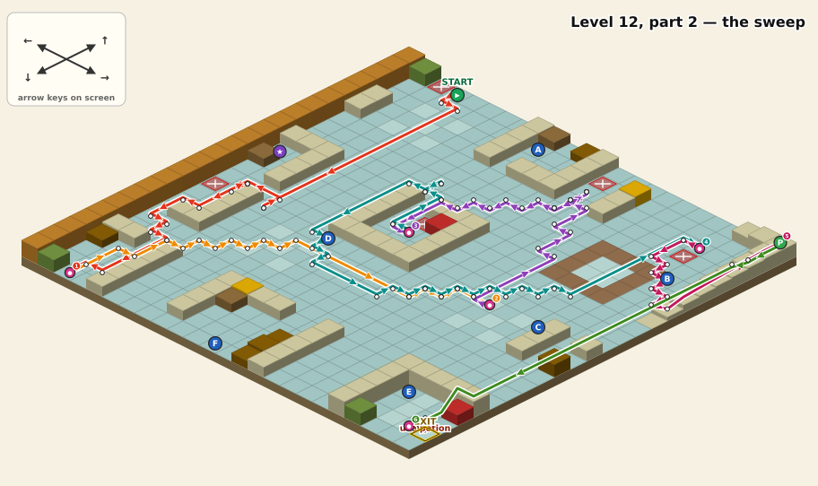</p>

<details>
<summary><b>⌨️ Key taps — Level 12, part 2: the sweep</b> (101 taps)</summary>

```
    START → 1 loot     ↓ 1   → 1   ↓ 12   ⚠↓ 0   ·3 ↑ 1   ← 2   ↓ 1   ⚠↑ 1   ↑ 0   ·6 ↓ 3   ← 1   ↓ 2   → 1   ↓ 1   → 1   ↓ 4   ← 1   ↓ 1
        1 → 2 loot     ↑ 3   → 1   ↑ 2   → 1   ↑ 1   → 1   ↑ 1   → 1   ↑ 1   → 1   ↑ 1   → 7   ↑ 1   → 1   ↑ 1   → 2
        2 → 3 loot     ⚠← 1   ⚠↑ 5   ← 1   ↑ 2   ← 1   ↑ 2   ← 1   ↑ 1   ↓ 1   ↓ 0   ·3 ↑ 1   ↓ 2   ⚠↓ 0   ·3 ↑ 2   ↑ 0   ·5 ↓ 2   ← 1   ↓ 1   ← 1   ↓ 1   ← 1   ↓ 1   ← 1   ↓ 3   → 1
        3 → 4 loot     ← 1   ↑ 3   ← 1   ↑ 1   ↑ 0   ·3 ↓ 1   ← 1   ↓ 6   → 1   ↓ 1   → 1   ↓ 1   → 4   ↑ 1   → 1   ↑ 1   → 1   ↑ 1   → 1   ↑ 1   → 1   ↑ 1   → 1   ↑ 1   → 1   ↑ 7   → 1
        4 → 5 potion   ← 1   ↓ 2   → 1   ↓ 1   → 1   ↓ 1   → 1   ↓ 1   → 1   ↑ 7
        5 → 6 loot     ↓ 2   ← 1   ↓ 19   🧪
        6 → EXIT       → 1
```

🔴 **Tight.** If you're caught, just try again; it only costs this level's points. In the model, this route got through 14% of runs with taps up to 1 tick late, 1% up to 2 ticks and 0% up to 3 ticks (a tick is about 1/15 s).

> [!IMPORTANT]
> 🎒 Arrive holding the ring (from level 11). Whatever you hold when a level starts comes back every time you retry it.
> **Leave still holding the ring for level 15**: don't spend it here beyond what the taps say.

</details>


#### ★ Bonus Level 2 — The Hidden Chamber

> *Hey, you found a secret chamber! Steal everything you can find and leave this cursed place!*

- No guards and no traps. The middle wall splits the room. Go round it, not over it.

<p align="center">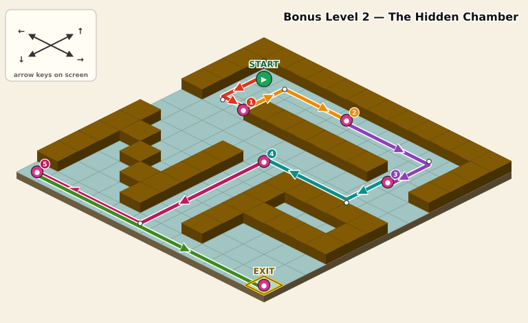</p>

<details>
<summary><b>⌨️ Key taps — Bonus Level 2</b> (9 taps)</summary>

```
    START → 1 loot     ↓ 2   → 1
        1 → 2 loot     ↑ 2   → 7
        2 → 3 loot     ↓ 4
        3 → 4 loot     ← 4
        4 → 5 loot     ↓ 6   ← 5
        5 → EXIT       → 11
```

🟢 **Forgiving.** In the model, this route got through 100% of runs with taps up to 1 tick late, 100% up to 2 ticks and 100% up to 3 ticks (a tick is about 1/15 s).

</details>


<div align="right"><sub><a href="#-contents">↑ back to top</a></sub></div>

---

### Level 13 — The Dungeons of Madness

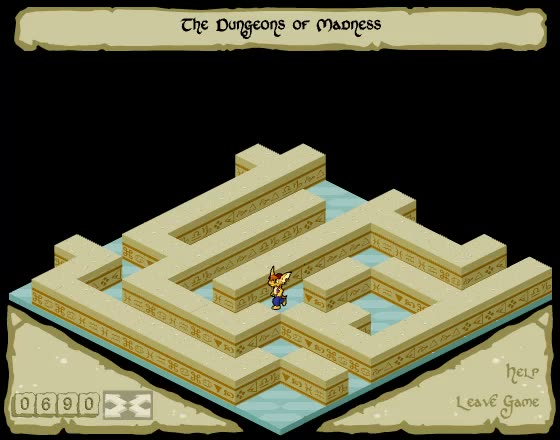

> *Not another crazy maze! Just try to find the exit my friend!*

| 💰 Points | 🍑 To steal | 🐘 Guards | 🕳️ Trapdoors | ⭐ Bonus room | 🗺️ Size |
|:-:|---|:-:|:-:|---|:-:|
| **60** | 1 loot | — | — | — | 36×36 |


- **The biggest maze**, 36×36 tiles, generated fresh every game. Same rules as level 5: start bottom corner, exit top corner, follow one wall. See [The three mazes](#-the-three-mazes).

<br clear="right">

<p align="center">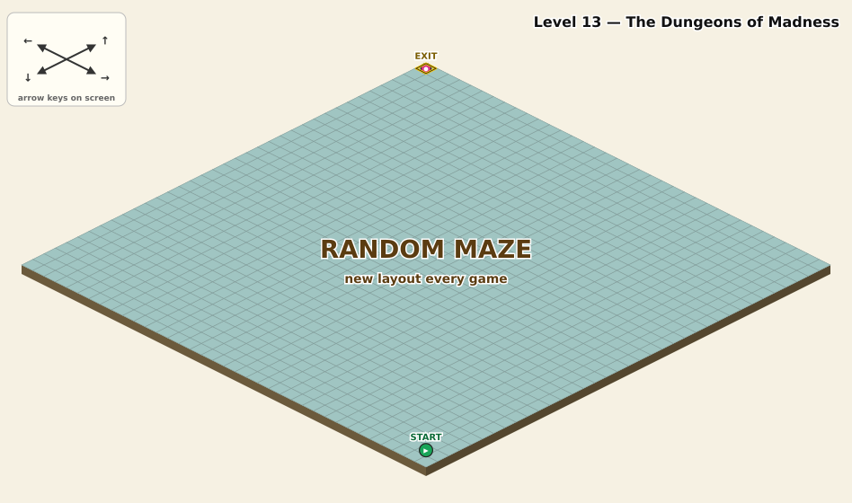</p>


<div align="right"><sub><a href="#-contents">↑ back to top</a></sub></div>

---

### Level 14 — Water World

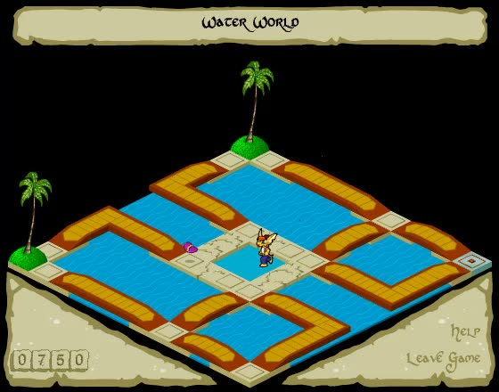

> *Hey, you're back Stan! Take a look around... what a peaceful place. No guards as far as the eye can see. Collect all the ummagines and make sure your feet don't get wet!*

| 💰 Points | 🍑 To steal | 🐘 Guards | 🕳️ Trapdoors | ⭐ Bonus room | 🗺️ Size |
|:-:|---|:-:|:-:|---|:-:|
| **50** | 4 loot | — | 76 | — | 12×12 |


- *"Make sure your feet don't get wet."* The water channels are trapdoors (red on the map), and so are a few path tiles that look solid. The planks and the stone paths are safe.
- No guards, so you can take your time. The four fruits sit around the small pool in the middle. The route goes straight through the pool's middle: the game counts those tiles as floor, not as a trapdoor.

<br clear="right">

<p align="center">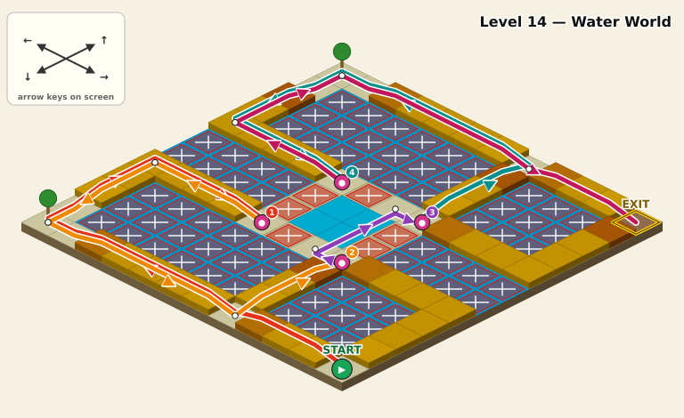</p>

<details>
<summary><b>⌨️ Key taps — Level 14</b> (17 taps)</summary>

```
    START → 1 loot     ← 11   ↑ 4   → 4
        1 → 2 loot     ← 4   ↓ 4   → 7   ↑ 4
        2 → 3 loot     ← 1   ↑ 3   → 1
        3 → 4 loot     ↑ 4   ← 7   ↓ 4   → 4
        4 → EXIT       ← 4   ↑ 4   → 11
```

🟢 **Forgiving.** In the model, this route got through 100% of runs with taps up to 1 tick late, 100% up to 2 ticks and 100% up to 3 ticks (a tick is about 1/15 s).

</details>


<div align="right"><sub><a href="#-contents">↑ back to top</a></sub></div>

---

### Level 15 — The Garden of The Holy Shrines

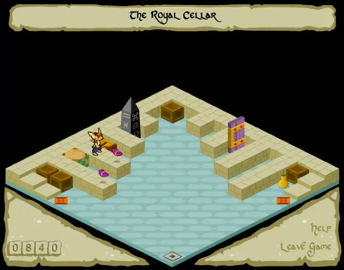

> *You made it in one piece But this looks tricky! Don't fool around with these guards. Better be careful!*

| 💰 Points | 🍑 To steal | 🐘 Guards | 🕳️ Trapdoors | ⭐ Bonus room | 🗺️ Size |
|:-:|---|:-:|:-:|---|:-:|
| **45** | 3 loot | 3 | 5 | ★ [Bonus Level 4](#-bonus-level-4--the-royal-cellar) | 12×12 |


- 🎒 You arrive with **the ring from level 11** (carried through levels 12–14 without using it). This is where you spend it.
- Go to the **bonus tile first**, while the guards are still at their posts. Mind the trapdoors around it.
- Back from Bonus Level 4, **put the ring on straight away** (💍 at the start of leg 2). While it lasts no guard will start a chase, so the long run past them to the three loot is safe.

<br clear="right">

<p align="center">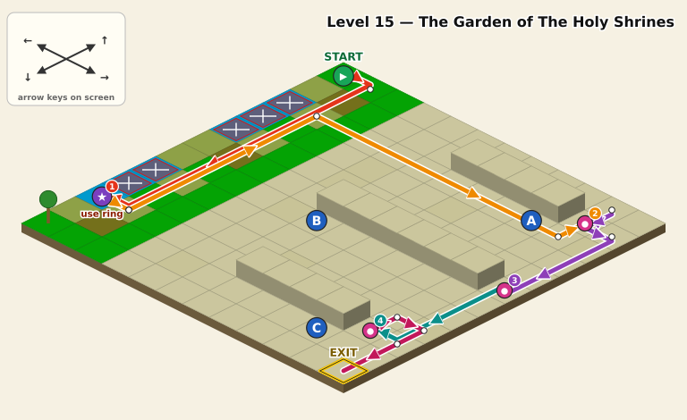</p>

<details>
<summary><b>⌨️ Key taps — Level 15</b> (15 taps)</summary>

```
    START → 1 ★ bonus  → 1   ↓ 9   ← 1
        1 → 2 loot     💍   → 1   ↑ 7   → 9   ↑ 2
        2 → 3 loot     ↓ 1   → 1   ↓ 8
        3 → 4 loot     ← 1
        4 → EXIT       ↑ 1   → 1   ↓ 3
```

🟢 **Forgiving.** In the model, this route got through 100% of runs with taps up to 1 tick late, 100% up to 2 ticks and 100% up to 3 ticks (a tick is about 1/15 s).

> [!IMPORTANT]
> 🎒 Arrive holding the ring (from level 11). This route **uses** it, so don't arrive without it. Whatever you hold when a level starts comes back every time you retry it.

</details>


#### ★ Bonus Level 4 — The Royal Cellar

> *What do you know?! You found a secret room filled with lots of loot! Steal everything you can find and get out of here!*

- No guards. The loot sits on raised blocks you can only climb onto from certain sides, which is why the route zig-zags.

<p align="center">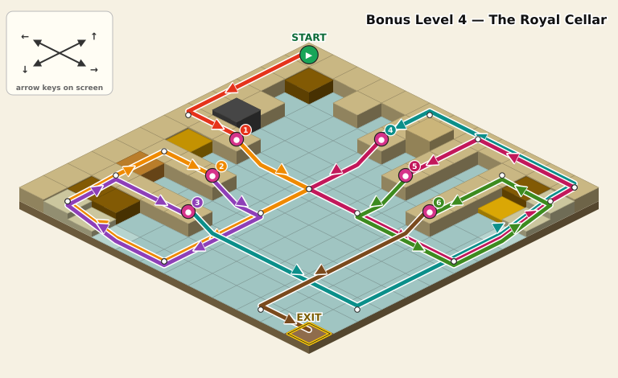</p>

<details>
<summary><b>⌨️ Key taps — Bonus Level 4</b> (22 taps)</summary>

```
    START → 1 loot     ↓ 5   → 5
        1 → 2 loot     ↓ 6   ← 4   ↑ 4   → 4
        2 → 3 loot     ↓ 4   ← 4   ↑ 2   → 10
        3 → 4 loot     ↑ 9   ← 6   ↓ 5
        4 → 5 loot     → 6   ↑ 5   ← 4   ↓ 5
        5 → 6 loot     → 4   ↑ 4   ← 2   ↓ 10
        6 → EXIT       → 2
```

🟢 **Forgiving.** In the model, this route got through 100% of runs with taps up to 1 tick late, 100% up to 2 ticks and 100% up to 3 ticks (a tick is about 1/15 s).

</details>


<div align="right"><sub><a href="#-contents">↑ back to top</a></sub></div>

---

### Level 16 — Endless Boardwalks

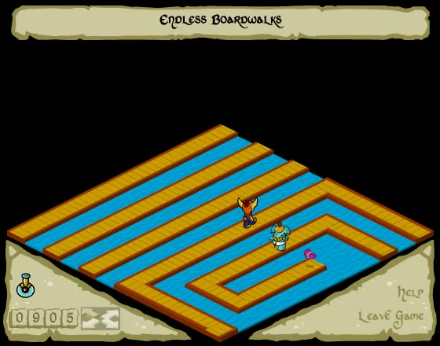

> *Welcome to the beach! Who built these boardwalks anyways? It looks like there is only one way to that fruit.. right through the guard! Good luck! *

| 💰 Points | 🍑 To steal | 🐘 Guards | 🕳️ Trapdoors | ⭐ Bonus room | 🗺️ Size |
|:-:|---|:-:|:-:|---|:-:|
| **55** | 2 loot · 1 potion | 1 | — | — | 24×24 |


- 🎒 You arrive with an empty bag, and that's fine: the potion is on this board.
- *"Only one way to that fruit… right through the guard"*: the boardwalks are a double spiral, and the route walks all the way into one coil to get the potion, back out, and then round to the loot. It is long (53 taps) but every run is a straight line along a walk.
- **Click the potion just before you reach the guard** (🧪 near the end of leg 2), then walk past him to the loot.
- Count your tiles. Many runs are 15–23 tiles long and the planks look alike; the map's numbers are the count.

<br clear="right">

<p align="center">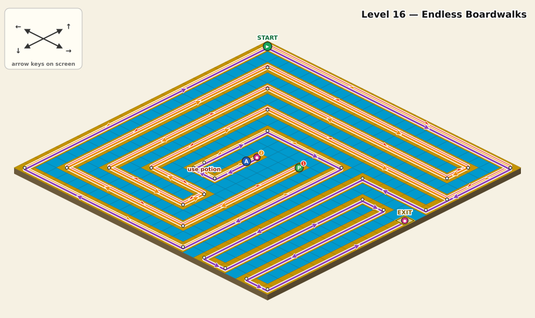</p>

<details>
<summary><b>⌨️ Key taps — Level 16</b> (53 taps)</summary>

```
    START → 1 potion   → 23   ↓ 6   ← 17   ↓ 11   → 5   ↓ 2   ← 7   ↑ 15   → 17   ↑ 2   ← 19   ↓ 19   → 11   ↑ 11
        1 → 2 loot     ↓ 11   ← 11   ↑ 19   → 19   ↓ 2   ← 17   ↓ 15   → 7   ↑ 2   ← 5   ↑ 11   → 17   ↑ 6   ← 23   ↓ 23   → 15   ↑ 15   ← 7   ↓ 6   🧪   → 2   ↑ 4
        2 → EXIT       ↓ 4   ← 2   ↑ 7   → 7   ↓ 15   ← 15   ↑ 23   → 23   ↓ 8   ← 6   ↓ 15   → 2   ↑ 13   → 2   ↓ 13   → 2   ↑ 13
```

🟡 **Needs good timing.** In the model, this route got through 100% of runs with taps up to 1 tick late, 80% up to 2 ticks and 43% up to 3 ticks (a tick is about 1/15 s).

</details>


<div align="right"><sub><a href="#-contents">↑ back to top</a></sub></div>

---

### Level 17 — The Raging Rivers

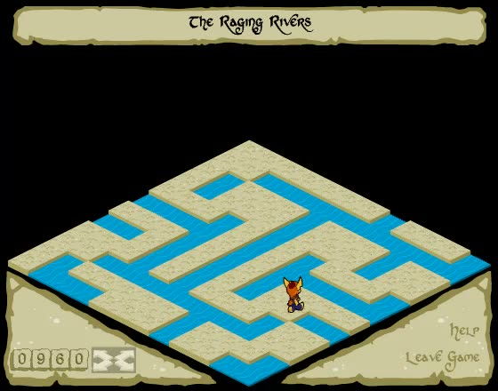

> *I have a bad feeling about this! Better stay away from the water. Many came here but only very few left alive...*

| 💰 Points | 🍑 To steal | 🐘 Guards | 🕳️ Trapdoors | ⭐ Bonus room | 🗺️ Size |
|:-:|---|:-:|:-:|---|:-:|
| **40** | 1 loot | — | — | — | 24×24 |


- **A river maze**, generated fresh every game. The water channels are the walls. Same method as level 5: see [The three mazes](#-the-three-mazes).

<br clear="right">

<p align="center">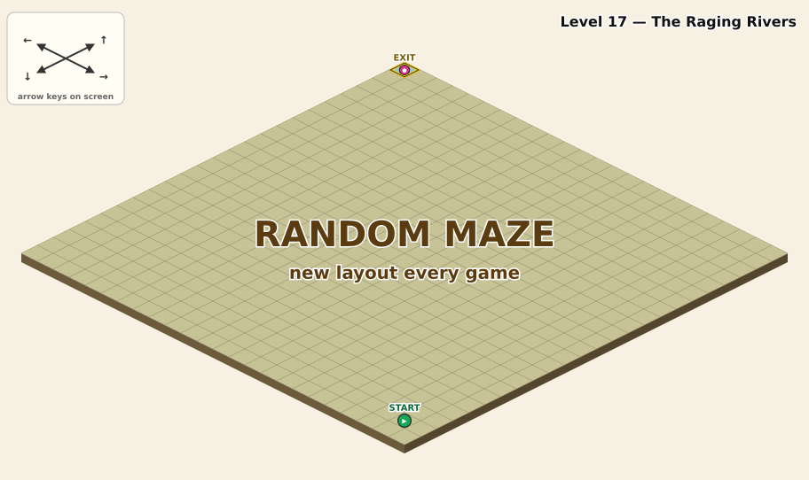</p>


<div align="right"><sub><a href="#-contents">↑ back to top</a></sub></div>

---

### Level 18 — The Swamps of Oblivion

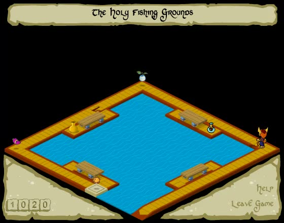

> *This doesn't look good! These swamps are treacherous. You have to reach safe ground before those guards bury you here!*

| 💰 Points | 🍑 To steal | 🐘 Guards | 🕳️ Trapdoors | ⭐ Bonus room | 🗺️ Size |
|:-:|---|:-:|:-:|---|:-:|
| **35** | 2 loot | 2 | 3 | ★ [Bonus Level 5](#-bonus-level-5--the-holy-fishing-grounds) | 12×12 |


- 🎒 You arrive with an empty bag. The potion you need comes from **Bonus Level 5**, so the route goes there **last**: both loot first, then the bonus tile in the top corner.
- Back from the room you're holding its potion. Walk down and **click it** (🧪) as the guards close in, then run left to the exit.
- **Don't get caught after the bonus room.** Its potion is gone for good if you are, and the room doesn't open again. The fallback route below works without items, but it needs exact taps.

<br clear="right">

<p align="center">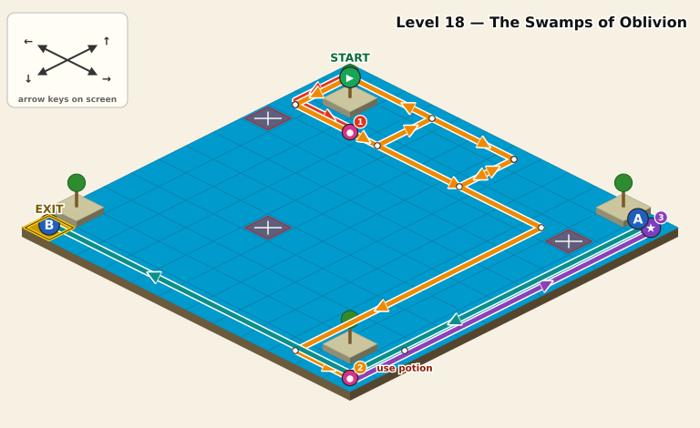</p>

<details>
<summary><b>⌨️ Key taps — Level 18</b> (15 taps)</summary>

```
    START → 1 loot     ↓ 2   → 3
        1 → 2 loot     ↑ 2   → 3   ↓ 2   ↑ 2   ← 6   ↓ 2   → 9   ↓ 9   → 2
        2 → 3 ★ bonus  ↑ 11
        3 → EXIT       ↓ 9   🧪   ← 11
```

🟡 **Needs good timing.** In the model, this route got through 100% of runs with taps up to 1 tick late, 100% up to 2 ticks and 53% up to 3 ticks (a tick is about 1/15 s).

</details>


#### ★ Bonus Level 5 — The Holy Fishing Grounds

> *Uh oh... I don't think you're supposed to be here. Leave as fast as you can or Sakhmet will put a curse on you!*

- *"Leave as fast as you can"*: there are no guards. The potion here goes into your bag, and level 18's route clicks it on the way to the exit. **Don't get caught on level 18 after this room:** the potion and its 15 points are gone for good if you are.

<p align="center">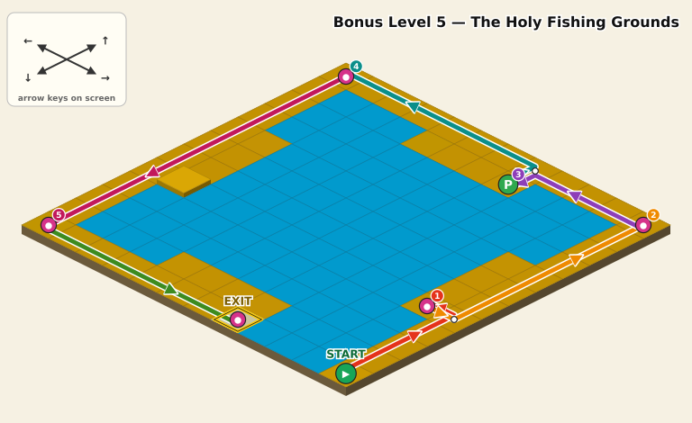</p>

<details>
<summary><b>⌨️ Key taps — Bonus Level 5</b> (10 taps)</summary>

```
    START → 1 loot     ↑ 4   ← 1
        1 → 2 loot     → 1   ↑ 7
        2 → 3 potion   ← 4   ↓ 1
        3 → 4 loot     ↑ 1   ← 7
        4 → 5 loot     ↓ 11
        5 → EXIT       → 7
```

🟢 **Forgiving.** In the model, this route got through 100% of runs with taps up to 1 tick late, 100% up to 2 ticks and 100% up to 3 ticks (a tick is about 1/15 s).

</details>


#### If you're caught after the bonus room

The bonus room's potion is gone for good once you're caught, and the room won't open again, so the main route no longer works. The level restarts with an empty bag and the guards back at their posts. This route needs no items, but its taps marked ⚠ have to land on the exact beat. Expect several tries.

<p align="center">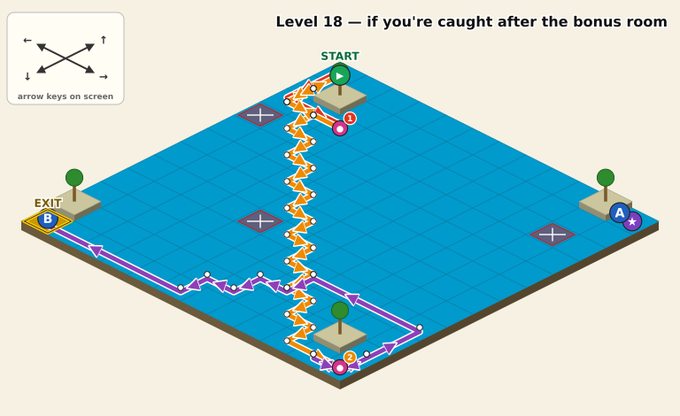</p>

<details>
<summary><b>⌨️ Key taps — Level 18 after the bonus room</b> (51 taps)</summary>

```
    START → 1 loot     ↓ 2   → 2
        1 → 2 loot     ← 1   ← 0   ·1 ← 1   ← 0   ·1 ↑ 1   ⚠↓ 1   ↓ 0   ·6 ↑ 1   ↑ 0   ·1 ↑ 1   ↑ 0   ·23 ↓ 2   → 1   ↓ 1   → 1   ↓ 1   → 1   ↓ 1   → 1   ↓ 1   → 1   ↓ 1   → 1   ↓ 1   → 1   ↓ 1   → 1   ↓ 1   → 1   ↓ 1   → 2
        2 → EXIT       ↑ 1   ⚠↓ 1   ← 1   → 1   ↑ 1   ⚠↓ 1   ↓ 0   ·3 ← 1   → 1   → 0   ·11 ↑ 3   ← 4   ↓ 1   ← 1   ↓ 1   ← 1   ↓ 1   ← 5
```

🔴 **Tight.** If you're caught, just try again; it only costs this level's points. In the model, this route got through 68% of runs with taps up to 1 tick late, 11% up to 2 ticks and 0% up to 3 ticks (a tick is about 1/15 s).

</details>


<div align="right"><sub><a href="#-contents">↑ back to top</a></sub></div>

---

### Level 19 — Eerie Suburbs

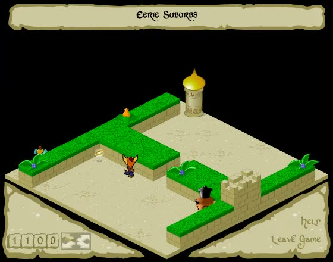

> *Back on solid ground! Not very friendly these suburbs! You'll need to steal all the fruits and make your way to the wooden door!*

| 💰 Points | 🍑 To steal | 🐘 Guards | 🕳️ Trapdoors | ⭐ Bonus room | 🗺️ Size |
|:-:|---|:-:|:-:|---|:-:|
| **90** | 3 loot · 2 ring | 3 | 1 | — | 24×24 |


- 🎒 You arrive with an empty bag. The two rings on this board are your only help: pick up the first, put it on (⚠💍) to get past the guards to the loot, then do the same with the second.
- **This route is tight.** Five ⚠ taps must land on the exact tick, and in the model only 16% of runs survive taps a tick late. Every failure only costs time: you restart this level, no points from earlier levels are lost.
- It's tight because of the bag: a route that arrives with level 18's potion is forgiving, but keeping that potion makes level 18 itself the tight level, and getting caught there loses the bonus room's 15 points. The guide puts the risk here instead, where retries are free.

<br clear="right">

<p align="center">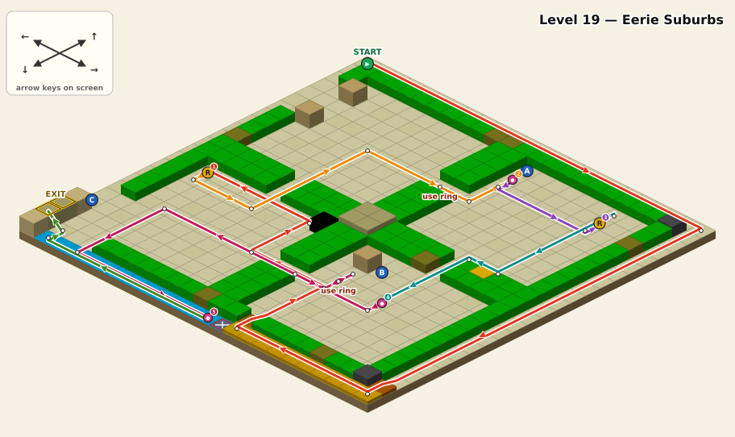</p>

<details>
<summary><b>⌨️ Key taps — Level 19</b> (30 taps)</summary>

```
    START → 1 ring     → 23   ↓ 23   ← 9   ↑ 6   ⚠← 5   ⚠↑ 4   ← 7
        1 → 2 loot     ↓ 1   → 4   ↑ 8   → 5   ⚠💍   ↑ 3
        2 → 3 ring     ↓ 1   → 6   ↑ 2
        3 → 4 loot     ↓ 8   ← 2   ↓ 7
        4 → 5 loot     ← 5   ⚠→ 2   ↑ 2   ↓ 1   ⚠💍   ← 11   ↓ 6   → 9
        5 → EXIT       ← 11   ↑ 1   ← 1
```

🔴 **Tight.** If you're caught, just try again; it only costs this level's points. In the model, this route got through 16% of runs with taps up to 1 tick late, 4% up to 2 ticks and 1% up to 3 ticks (a tick is about 1/15 s).

</details>


<div align="right"><sub><a href="#-contents">↑ back to top</a></sub></div>

---

### Level 20 — The Path of Sakhmet

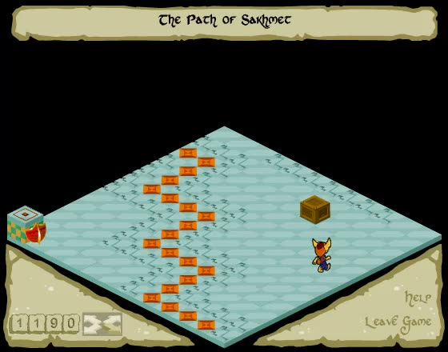

> *Your final task awaits you! Follow the path of Sakhmet. But don't get fooled - it's not as easy as it may seem! Find the ummagine and you are going to have a feast tonight!!!*

| 💰 Points | 🍑 To steal | 🐘 Guards | 🕳️ Trapdoors | ⭐ Bonus room | 🗺️ Size |
|:-:|---|:-:|:-:|---|:-:|
| **60** | 1 loot | — | 534 | — | 36×36 |


- **No guards, and the whole board is trapdoor except one winding path.** This is the level to count tiles carefully on. Every red tile on the map is a trapdoor, and most look like ordinary floor.
- The fruit is on the exit tile at the top corner. Reach it and the game is over. 🎉

<br clear="right">

<p align="center"></p>

<details>
<summary><b>⌨️ Key taps — Level 20</b> (38 taps)</summary>

```
    START → EXIT       ← 3   ↑ 3   ← 3   ↑ 3   ← 3   ↑ 3   ← 3   ↓ 3   ← 3   ↓ 1   ← 3   ↑ 5   → 1   ↑ 3   → 13   ↓ 1   → 3   ↑ 5   → 1   ↑ 14   ← 2   ↑ 2   ← 4   ↓ 2   ← 10   ↓ 3   ← 3   ↑ 3   ← 3   ↓ 3   ← 3   ↑ 3   ← 3   ↓ 3   ← 3   ↑ 3   ← 3   ↑ 3
```

🟢 **Forgiving.** In the model, this route got through 100% of runs with taps up to 1 tick late, 100% up to 2 ticks and 100% up to 3 ticks (a tick is about 1/15 s).

</details>


<div align="right"><sub><a href="#-contents">↑ back to top</a></sub></div>


---

## 🌀 The three mazes

Levels **5, 13 and 17** are hedge, stone and river mazes that the game **generates fresh every time you play**, so no map can show them. They have no guards and no traps.

- You start in the **bottom corner**. The exit, marked by the fruit, is in the **top corner**. Overall you're heading **up** the screen, which means tapping ↑ and ←.
- **Follow one wall.** Pick a hand and keep the wall on that side. When it turns, turn with it, and when there's an opening on your side, take it. In a maze like these, where every wall joins up, this always reaches the exit. It's slower than the best path but you never get lost.
- The corridors are on a 2-tile grid: junctions come every **2 tiles**, never in between. Tap, count two tiles, decide.
- Level 13 is the big one: 36×36 tiles, 18 junctions across.

---

## 🪤 Traps that cost the most points

<table>
<tr><td>🎣</td><td><b>Don't get caught after Bonus Level 5.</b> The potion in Bonus Level 5 adds its 15 points to level 18's running score, not straight to your total. Bonus rooms can't be entered twice, so if you're caught on level 18 after the room, those 15 points are gone and the most you can score is 1,235. On level 18, do the bonus room <b>last</b> if you can, and play the walk from it to the exit very carefully.</td></tr>
<tr><td>⏹️</td><td><b>A double tap is a brake.</b> Tapping the direction Stan is already walking in stops him, so holding the key down makes him stop and start. Tap once per turn.</td></tr>
<tr><td>↪️</td><td><b>An early tap turns too soon.</b> Stan turns on the tile he's on when you tap. If you tap before he reaches the turning tile, he turns one tile early, sometimes into a guard's path or onto a trapdoor.</td></tr>
<tr><td>🕳️</td><td><b>Trapdoors look like floor.</b> On levels 9 and 20 almost the whole floor is trapdoors, and they look like every other tile. Follow the map, not the floor pattern.</td></tr>
<tr><td>🚪</td><td><b>The exit won't open with anything left behind.</b> If you reach it and nothing happens, you missed a piece of loot. Potions and rings count as loot, so you have to pick them up even if you don't plan to use them.</td></tr>
<tr><td>🧪</td><td><b>You can only hold one potion and one ring.</b> Picking up a second potion while you hold one still scores 15 points, but you don't get a second dose. Use the one you're carrying first.</td></tr>
<tr><td>🔑</td><td><b>Level codes skip points.</b> A run started from a level code doesn't include the earlier levels, so it can't reach 1,250.</td></tr>
<tr><td>⌨️</td><td><b><code>ummaginethief</code> isn't a shortcut.</b> Typing it during play skips the level, but it also <b>resets your score to 0</b>. It's handy for practising a late level, and useless for a real run.</td></tr>
</table>

---

<div align="center">

*Grand Theft Ummagine, Kyrii Stan and all game art © Neopets, Inc. This is a fan guide and isn't affiliated with Neopets.*

</div>
